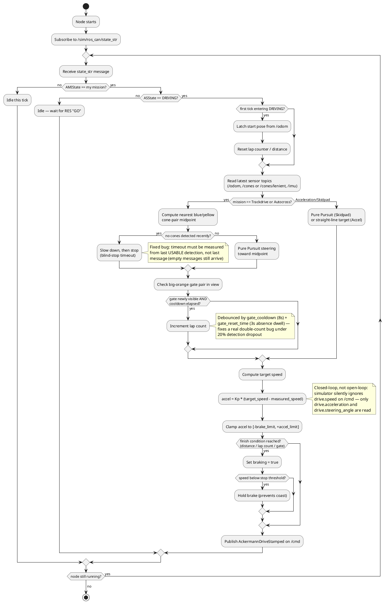
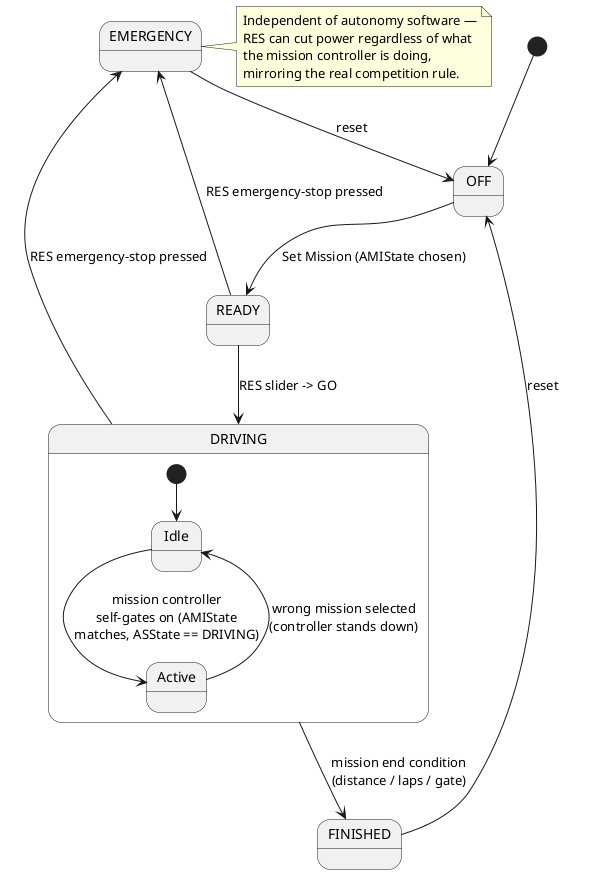
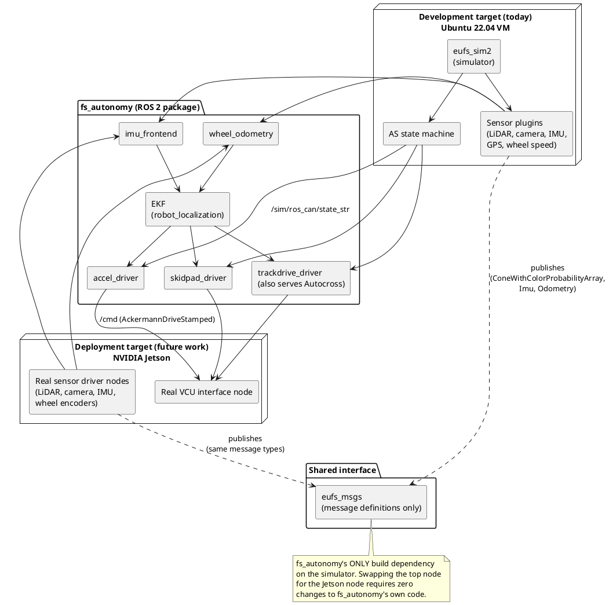
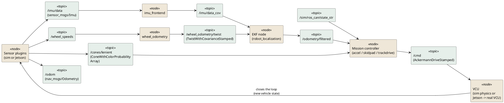
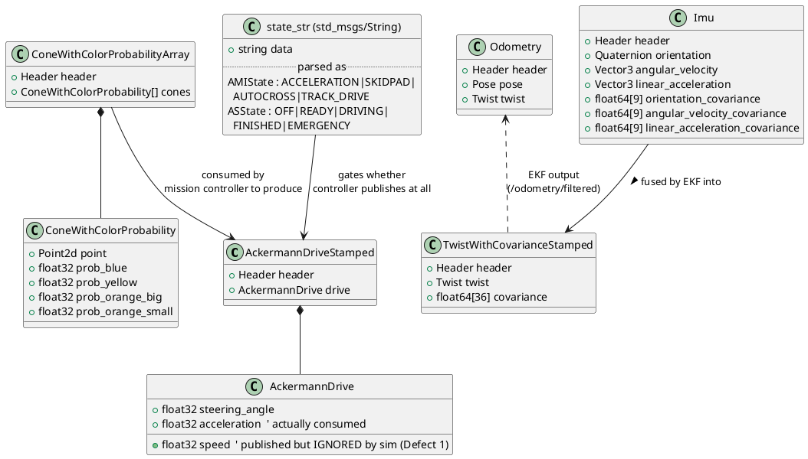

# System Diagrams — PlantUML Source

Six diagrams covering the assignment's checklist: a complete flowchart (decisions,
errors, repeated operations), a UML diagram, a state diagram, a data-flow diagram, a
timing diagram, and — since no database is used — a data-design diagram (class
diagram of the ROS message schema) in place of an ER diagram.

Paste each block into your PlantUML generator separately (one `@startuml`/`@enduml`
block = one diagram = one export). All six are self-contained; none depend on each
other. Deployment target is labelled **NVIDIA Jetson**, matching the project's actual
future-work target (not Raspberry Pi) — swap the label in Diagram 3 if your team is
actually targeting a Pi instead.

---

## 1. Flowchart — Mission Controller Execution (Activity Diagram)

**What it shows:** the generic control loop every one of the four mission
controllers (Acceleration, Skidpad, Trackdrive, Autocross) runs, including the state
gate, the closed-loop speed-control workaround for a real simulator bug, the
perception-gate debounce logic that fixed a real double-counting bug, and the
message-publish loop that repeats every tick.



---

## 2. State Diagram — Autonomous System (AS) State Machine

**What it shows:** the official FS Driverless AS state machine as implemented by
eufs\_sim2 and driven externally by the RES (Remote Emergency Stop) slider and
emergency-stop button — not something the team built, but the exact interface every
mission controller gates on.



---

## 3. UML Component / Deployment Diagram — System Architecture

**What it shows:** the containment architecture — `fs_autonomy`'s only shared
dependency with the simulator is `eufs_msgs`, so the simulator can be swapped for
real driver nodes on an NVIDIA Jetson with no code change. Two deployment nodes are
shown side by side (today vs. future) sharing the identical topic contract.



---

## 4. Data-Flow Diagram — Topics Between Nodes

**What it shows:** the actual ROS 2 topic graph as data flow — every arrow is a
real topic name and message type, not an abstraction. This doubles as the
"data design" required in place of an ER diagram, since there is no database in
this system; all state lives in in-memory node state and ROS topics.



---

## 5. Timing Diagram — Sensor, Fusion and Control Loop Rates

**What it shows:** the real update rates involved, which matter because the EKF
fuses two sensor streams at different natural rates and the control loop must not
run faster than the data it depends on.

```plantuml
@startuml timing_rates
robust "LiDAR / cone detection" as lidar
robust "IMU" as imu
robust "Wheel speed" as wheel
robust "EKF fusion" as ekf
robust "Mission controller tick" as ctrl

lidar has Idle, Publish
imu has Idle, Publish
wheel has Idle, Publish
ekf has Idle, Fuse
ctrl has Idle, Compute

@0
lidar is Idle
imu is Idle
wheel is Idle
ekf is Idle
ctrl is Idle

@0
imu is Publish
@5
imu is Idle
@20
imu is Publish
@25
imu is Idle

@0
wheel is Publish
@10
wheel is Idle
@20
wheel is Publish
@30
wheel is Idle

@0
lidar is Publish
@50
lidar is Idle
@100
lidar is Publish
@150
lidar is Idle

@2
ekf is Fuse
@4
ekf is Idle
@22
ekf is Fuse
@24
ekf is Idle
@32
ekf is Fuse
@34
ekf is Idle

@6
ctrl is Compute
@8
ctrl is Idle
@26
ctrl is Compute
@28
ctrl is Idle

@100
lidar is Publish

note right of ekf : EKF runs at 50 Hz (20 ms period),\nfusing IMU (~100-200 Hz effective)\nand wheel odometry (~100 Hz) —\nfaster than either sensor alone needs,\nso it never waits on a stale value.
note right of lidar : Cone detection is the slowest\nstream (~10-20 Hz) — the mission\ncontroller tolerates this via the\nblind-stop timeout, not by blocking.

@enduml
```

---

## 6. Data Design — ROS Message Schema (in place of an ER diagram)

**What it shows:** this project uses no database — all data is transient, in-memory
ROS messages passed between nodes. This class diagram is the equivalent "data
design" artifact: the schema of every message type that actually crosses a node
boundary, with the fields each controller reads.



---

### Brief explanations (for the submission writeup)

1. **Flowchart** — every mission controller is one state-gated loop; the two
   `note` callouts mark the two real bugs the error-handling logic was written to
   work around (silent `drive.speed`, lap double-counting).
2. **State diagram** — the AS state machine is provided by eufs\_sim2 (and by the
   real competition rules), not built by the team; it is the external trigger every
   controller's gate depends on.
3. **Component/deployment diagram** — visualises the "one shared dependency"
   claim directly: both the simulator and the Jetson deployment node connect to
   `fs_autonomy` through the same `eufs_msgs` contract.
4. **Data-flow diagram** — every arrow is a real topic name; this is the literal
   wiring of the system, not a simplification.
5. **Timing diagram** — shows why the EKF runs faster than either fused sensor
   needs to (never blocks on stale data) while the control loop tolerates the
   slower, noisier cone-detection stream via an explicit timeout rather than by
   blocking.
6. **Data design** — substitutes for an ER diagram since no database exists;
   documents the actual schema and field-level provenance of every message that
   crosses a node boundary, including which fields are silently unused (Defect 1).
